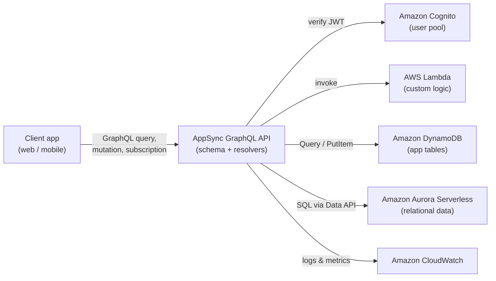
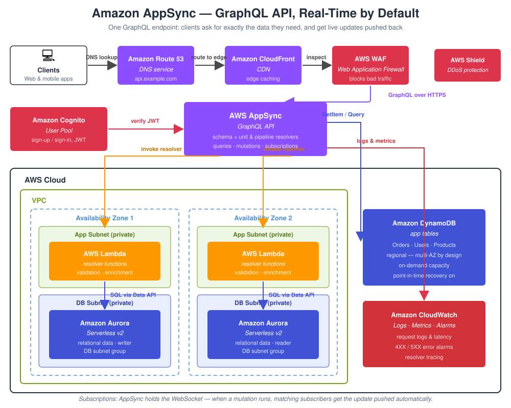

# AWS AppSync GraphQL Guide


> One endpoint, exactly the data you asked for — nothing more, nothing less.

## TL;DR

**AWS AppSync** is a managed GraphQL service. Instead of building a REST API with a dozen endpoints — one for the user profile, one for their orders, one for each product — you expose **one GraphQL endpoint** and let the client ask for exactly the fields it needs, in a single request. AppSync handles the plumbing: it checks who you are, runs your resolvers, fans out to your data sources (DynamoDB, Lambda, RDS, OpenSearch, HTTP), merges the answers, and — the part REST can't do without extra work — pushes live updates to clients over WebSockets when data changes.



## 🌍 In plain words — what is this, really?

Imagine a restaurant. With a **REST API**, ordering dinner works like this: you walk to the drinks counter to order water, then to the kitchen counter to order food, then to the dessert counter — three separate trips, and each counter hands you a fixed tray. You asked for water and got water *plus* a bread basket you didn't want (that's **over-fetching**). If you want to know when your food is ready, you have to keep walking back to ask (that's **polling**).

**GraphQL with AppSync** is a restaurant with one good waiter. You sit down, hand the waiter a single slip of paper that says exactly what you want — "water, the chicken, no bread, and tell me the moment it's ready" — and the waiter does the running around for you. The waiter visits the drinks station, the kitchen, the dessert counter, collects exactly what you asked for, and brings it back on one tray. When your food is ready, the waiter comes to *you* — you never have to ask twice (that's a **subscription**).

Three ideas from that picture carry the whole guide:

- **The schema is the menu (one contract).** The GraphQL schema lists every dish the kitchen can make — every type, field, query, and mutation. The client reads the menu and orders from it; the kitchen never has to guess. If a field isn't on the menu, it can't be ordered.
- **Resolvers are the waiter's legs (one field = one job).** Each field in the schema has a resolver — a small piece of logic that knows where that piece of data lives. The `user` field asks DynamoDB; the `recommendations` field asks a Lambda function; the `orderHistory` field asks Aurora. AppSync runs them in parallel and assembles the plate.
- **Subscriptions are the waiter coming back to you (real-time).** A client subscribes to `onNewOrder`, and the moment a mutation creates an order, AppSync pushes it to every subscribed client over a WebSocket. No polling, no extra endpoint, no websockets server to run yourself.

If you only remember one sentence: **AppSync lets clients ask for exactly what they need, once, and get live updates for free.**

## The Problem With REST APIs for Modern Apps

A mobile app's home screen needs a user profile, the last five orders, and three recommended products. With REST, that is usually three or more round trips — slow on a bad connection — and each response carries fields the screen never displays. The problems:

- **Over-fetching** — `/users/42` returns 40 fields when the screen shows 6. Bandwidth and battery pay for the rest.
- **Under-fetching / N+1 requests** — one endpoint per resource means the client chats back and forth to assemble one screen.
- **Real-time is DIY** — live updates need a WebSocket server, connection management, reconnection logic, and fan-out code you write and operate yourself.
- **Versioning pain** — changing a response shape means `/v2` endpoints, and old clients break if you move too fast.

GraphQL fixes the first three by design: the client declares its data shape, the server resolves it in one round trip, and subscriptions are built into the protocol. AppSync fixes the fourth by being managed — no servers, no WebSocket infrastructure, and schema changes are additive by default.

## Architecture



The request flow, in five steps:

1. **Resolve** — the client resolves the API's custom domain through **Route 53**, and the request passes through **CloudFront** (edge caching) and **AWS WAF** (bad-request filtering).
2. **Authenticate** — AppSync verifies the caller's token against **Amazon Cognito** (or an API key, IAM credentials, OIDC, or a Lambda authorizer — see the auth table below).
3. **Resolve fields** — for each field in the query, AppSync runs its **resolver**: a unit resolver for one data source, or a pipeline resolver that chains several functions.
4. **Fetch** — resolvers read and write the data sources: **DynamoDB** for app tables, **Lambda** for custom logic, **Aurora Serverless** for relational queries via the Data API.
5. **Observe** — every request, error, and latency number lands in **CloudWatch Logs and Metrics**, and alarms fire when error rates cross a threshold.

## Schema-First Design

In AppSync you design the **schema first**, then wire resolvers to it. The schema is the contract between frontend and backend teams — they can work in parallel once it exists.

```graphql
# schema.graphql — a tiny shop API (also embedded in main.tf)
type Order {
  id: ID!
  userId: String!
  total: Float!
  status: String!
  createdAt: AWSDateTime!
}

type Query {
  getOrder(id: ID!): Order        # one order, by id
  listOrders(userId: String!): [Order]
}

type Mutation {
  createOrder(userId: String!, total: Float!): Order
}

type Subscription {
  onNewOrder(userId: String!): Order
    @aws_subscribe(mutations: ["createOrder"])
}
```

A few things worth noticing:

- `!` means "this field is never null" — the schema documents its own guarantees.
- `AWSDateTime` is one of AppSync's built-in **scalar types** (alongside `AWSEmail`, `AWSJSON`, `AWSPhone`, and more) — they validate input for you.
- `@aws_subscribe` ties the subscription to the `createOrder` mutation: whenever that mutation runs, subscribed clients get the new order pushed to them. The client never polls.

**Design rule:** model the schema around *how the client reads the data* (the screens), not around how the tables are stored. If two screens need the same data shaped differently, add a field — don't add an endpoint.

## Resolvers: Unit vs Pipeline

A **resolver** connects one schema field to one data source. There are two shapes:

| | Unit resolver | Pipeline resolver |
|---|---|---|
| What it is | One field → one data source, one request | One field → a chain of functions, run in order |
| Example | `getOrder` → DynamoDB `GetItem` | `createOrder` → validate stock (Lambda) → write order (DynamoDB) → publish event (EventBridge) |
| Logic language | VTL mapping template, or JavaScript (APPSYNC_JS runtime) | JavaScript functions, composed with `before` / `after` steps |
| When to use it | Simple CRUD reads and writes | Anything with more than one step, validation, or side effects |

**VTL vs JavaScript:** VTL (Velocity Template Language) is the original resolver language — terse, and easy to get wrong. The newer **APPSYNC_JS runtime** lets you write resolvers in plain JavaScript/TypeScript with `util.error()` and `util.appendError()` helpers. For new APIs, prefer JavaScript: it is easier to read, test, and review.

```javascript
// resolvers/getOrder.js — unit resolver, DynamoDB data source
import { util } from '@aws-appsync/utils';

export function request(ctx) {
  return {
    operation: 'GetItem',
    key: util.dynamodb.toMapValues({ id: ctx.args.id }),
  };
}

export function response(ctx) {
  if (ctx.error) util.error(ctx.error.message, ctx.error.type);
  return ctx.result; // returned straight to the client
}
```

## Auth Modes — Picking the Right One

AppSync supports four built-in auth modes (plus a Lambda authorizer). Most APIs need exactly one primary mode, and optionally more as **additional authorization providers**.

| Mode | How it works | Best for | Watch out for |
|---|---|---|---|
| **API key** | A static key in the request header | Prototypes, public read-only data, quick demos | Anyone with the key can call the API; keys expire (max 365 days) — never use for user data |
| **Amazon Cognito user pools** | The client sends a JWT from a Cognito sign-in | Real apps with sign-up / sign-in | Tokens expire; handle refresh in the client |
| **AWS IAM** | Requests signed with SigV4 | Server-to-server calls, Amplify apps with guest roles | Clients need AWS credentials — not for browsers without a proper identity flow |
| **OpenID Connect** | A JWT from your own identity provider (Auth0, Okta, …) | You already have an IdP | AppSync trusts the issuer — a misconfigured issuer is a security hole |
| **Lambda authorizer** | Your function returns allow/deny per request | Custom rules (feature flags, IP checks, token introspection) | It runs on every request — keep it fast and cacheable |

**Practical default:** Cognito user pools for user-facing apps, IAM for backend services calling the API, API keys only for throwaway prototypes. The Terraform sample in this repo wires Cognito as the default auth mode and adds an API key as an *additional* provider for local development.

## Data Sources Compared

| Data source | Strengths | Trade-offs | Reach for it when… |
|---|---|---|---|
| **DynamoDB** | Single-digit-ms reads, scales to zero ops thinking, native `@model` feel | No joins, no ad-hoc queries — design access patterns first | Your app data is key-value / document-shaped |
| **AWS Lambda** | Any logic, any language, any downstream call | Cold starts, you write the code | You need validation, third-party APIs, or orchestration |
| **Aurora Serverless (RDS)** | Real SQL, joins, transactions | Data API has per-request latency; connection management matters | Your data is genuinely relational |
| **OpenSearch** | Full-text search, aggregations, filters | Another cluster to tune and pay for | You need "search products by name" to actually work well |
| **HTTP** | Call any REST endpoint as a resolver | You inherit that endpoint's latency and limits | Wrapping a legacy service behind GraphQL |
| **EventBridge** | Publish domain events from a mutation | One-way by nature — no response data | `createOrder` should also notify the warehouse |

**Rule of thumb:** start with DynamoDB for the hot paths and Lambda for the logic that doesn't fit a table. Add Aurora when you genuinely need SQL; add OpenSearch when search becomes a feature, not a hope.

## Real-Time Subscriptions

Subscriptions are the feature that makes AppSync hard to replace with "just a Lambda behind API Gateway". The flow:

1. Client subscribes: `subscription { onNewOrder(userId: "42") { id total status } }`.
2. AppSync holds the WebSocket connection — you run nothing.
3. Any client runs the `createOrder` mutation.
4. AppSync pushes the new order to every client subscribed with a matching `userId` argument. Filters are evaluated server-side, so clients only receive their own data.

**Security note:** a subscription is only as safe as its filter. `@aws_subscribe` alone does not check ownership — combine it with Cognito auth and field-level `@aws_auth` directives (or resolver-level checks on `ctx.identity`) so user A never receives user B's orders.

## Caching

AppSync has built-in **per-resolver caching** (backed by an in-memory cache you size in the console or Terraform). Turn it on for resolvers that serve hot, slowly-changing data — product catalogues, config, reference lists. A cache hit skips the data source entirely, which cuts both latency and DynamoDB read costs.

- Cache **queries**, never mutations — a cached write is a bug.
- Set a **TTL** that matches how stale the data may be (30–300 seconds is a sane starting range).
- Invalidate deliberately: a `createOrder` mutation can evict the cached `listOrders` result for that user.

## Quick Start

Prerequisites: Terraform ≥ 1.5 and AWS credentials with permission to create AppSync, DynamoDB, Lambda, Cognito, IAM, and CloudWatch resources.

```bash
git clone https://github.com/sepkascurty-cpu/aws-appsync-graphql-guide.git
cd aws-appsync-graphql-guide
terraform init
terraform plan    # review: AppSync API, DynamoDB table, Lambda resolver, Cognito pool
terraform apply
```

The apply prints the GraphQL endpoint and API key. Try it with `curl`:

```bash
API_URL=$(terraform output -raw graphql_url)
API_KEY=$(terraform output -raw api_key)

curl -X POST "$API_URL" \
  -H "Content-Type: application/json" \
  -H "x-api-key: $API_KEY" \
  -d '{"query": "mutation { createOrder(userId: \"42\", total: 59.99) { id total status } }"}'
```

Then query it back:

```bash
curl -X POST "$API_URL" \
  -H "Content-Type: application/json" \
  -H "x-api-key: $API_KEY" \
  -d '{"query": "{ listOrders(userId: \"42\") { id total status } }"}'
```

**Cost warning:** AppSync bills per million queries/mutations and per subscription connection-minute; DynamoDB on-demand and Aurora Serverless scale with use. Run `terraform destroy` when you're done experimenting — the sample is built to be destroyed cleanly.

## Best Practices

1. **Schema first, code second.** Agree the schema with the frontend team before writing resolvers — it is the API contract, and changing it later breaks clients.
2. **One field, one resolver, one job.** If a resolver does three things, split it into a pipeline of small functions — each one testable on its own.
3. **Prefer JavaScript resolvers (APPSYNC_JS)** over VTL for new code — readable, testable, and the direction AWS is heading.
4. **Never trust the client for authorization.** Check `ctx.identity` (Cognito claims, groups) inside resolvers, especially in subscriptions and mutations.
5. **Design DynamoDB access patterns before the schema**, not after. GraphQL makes it tempting to add "just one more field" — each field is a read against a table that may not support it.
6. **Cache the hot reads, not the writes.** Per-resolver caching with a short TTL is the cheapest latency win AppSync offers.
7. **Log everything, alarm on errors.** Enable CloudWatch logging on the API and alarm on `4XXError` / `5XXError` — a broken resolver fails silently for the client otherwise (partial data, no error page).
8. **Use pipeline resolvers for multi-step mutations** (validate → write → publish event) instead of cramming the logic into one Lambda.
9. **Version by addition, not by breaking.** Add fields and types; deprecate with `@deprecated` instead of deleting — old app versions in the wild will thank you.
10. **Destroy what you demo.** AppSync, DynamoDB on-demand, and Aurora Serverless all cost money while they exist — `terraform destroy` is part of the workflow.

## Troubleshooting

| Symptom | Likely cause | Fix |
|---|---|---|
| `Unauthorized` on every request | Wrong auth mode, expired API key, or missing `Authorization` header | Check the API's auth config; rotate the key; send the Cognito JWT as `Authorization: <token>` |
| Field returns `null` with no error | Resolver returned nothing, or the mapping template swallowed an error | Enable CloudWatch logging; check `ctx.error` in the response mapping template |
| `Unable to parse` / schema errors on deploy | Invalid GraphQL syntax in the schema | Validate with `npx graphql-schema-linter` or paste the schema into the AppSync console's schema editor |
| Subscription never fires | Mutation and subscription aren't linked with `@aws_subscribe`, or the filter arguments don't match | Check the directive and that the mutation's return fields include the subscription's filter fields |
| Slow first request after idle | Lambda resolver cold start | Use provisioned concurrency for the resolver function, or move the hot path to a DynamoDB direct resolver |
| `Validation error: field X is not defined` | Client queries a field the schema doesn't have (often after a schema change) | Regenerate the client code (Amplify codegen / graphql-codegen) from the deployed schema |
| Costs climbing unexpectedly | Subscription connections held open, or cache disabled on a hot resolver | Audit active connections in CloudWatch; enable per-resolver caching on hot queries |

## AppSync vs API Gateway + Lambda (REST)

| | AppSync (GraphQL) | API Gateway + Lambda (REST) |
|---|---|---|
| Client data fetching | One request, exact fields | One endpoint per resource, often over/under-fetching |
| Real-time updates | Built-in subscriptions over WebSockets | DIY — WebSocket API, connection table, fan-out code |
| Client contract | Typed schema, introspectable, codegen-friendly | OpenAPI spec you maintain by hand |
| Caching | Per-resolver, one toggle | Per-method, plus your own cache logic |
| Learning curve | GraphQL concepts (schema, resolvers, directives) | Familiar HTTP semantics |
| Best fit | Mobile/web apps with complex screens and live data | Public APIs, webhooks, simple CRUD services |

## Repository Layout

```
.
├── README.md          # this guide
├── architecture.svg   # AppSync request-flow diagram (classic AWS style)
└── main.tf            # Terraform: AppSync API + Cognito + DynamoDB + Lambda resolver
```

## Further Reading

- [AWS AppSync Developer Guide](https://docs.aws.amazon.com/appsync/latest/devguide/what-is-appsync.html)
- [GraphQL spec — queries, mutations, subscriptions](https://spec.graphql.org/)
- [APPSYNC_JS runtime reference](https://docs.aws.amazon.com/appsync/latest/devguide/appsync-js-reference.html)
- [AWS Well-Architected — Serverless Lens](https://docs.aws.amazon.com/wellarchitected/latest/serverless-applications-lens/welcome.html)
